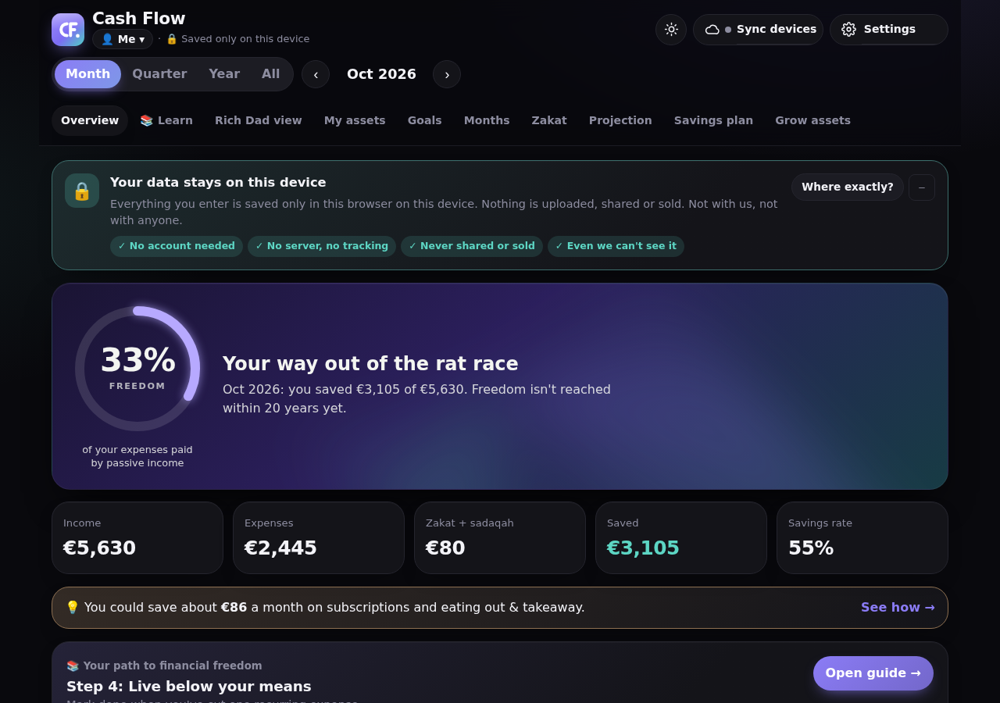
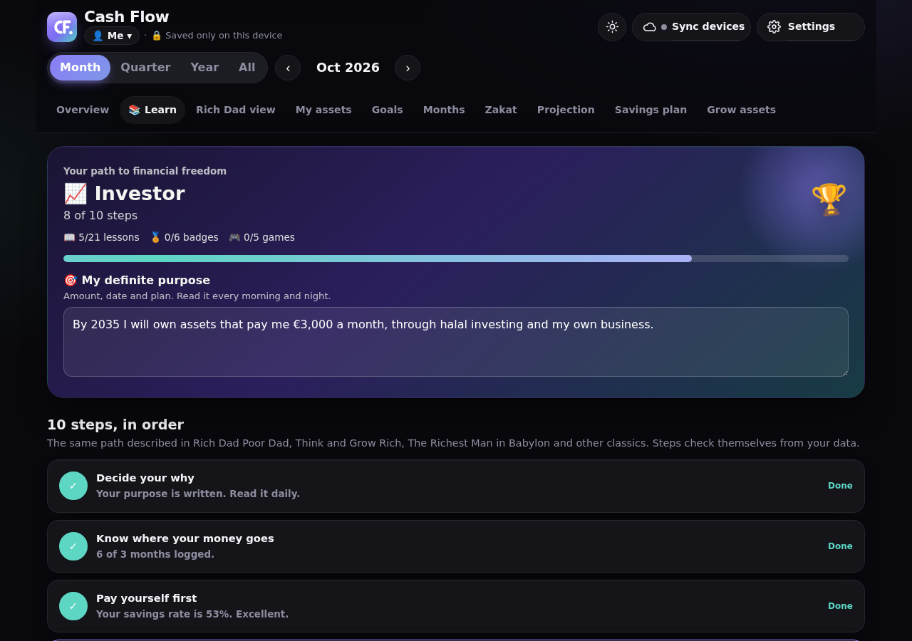
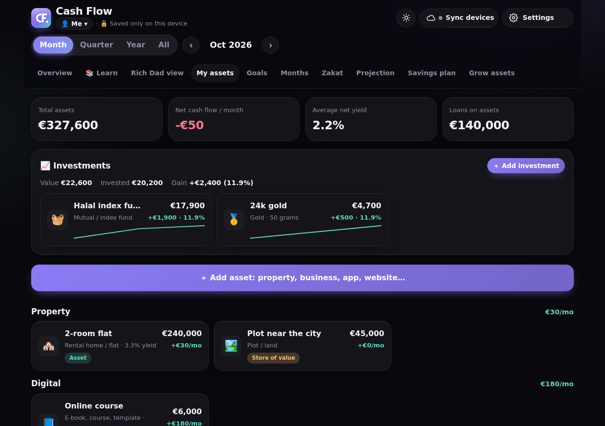
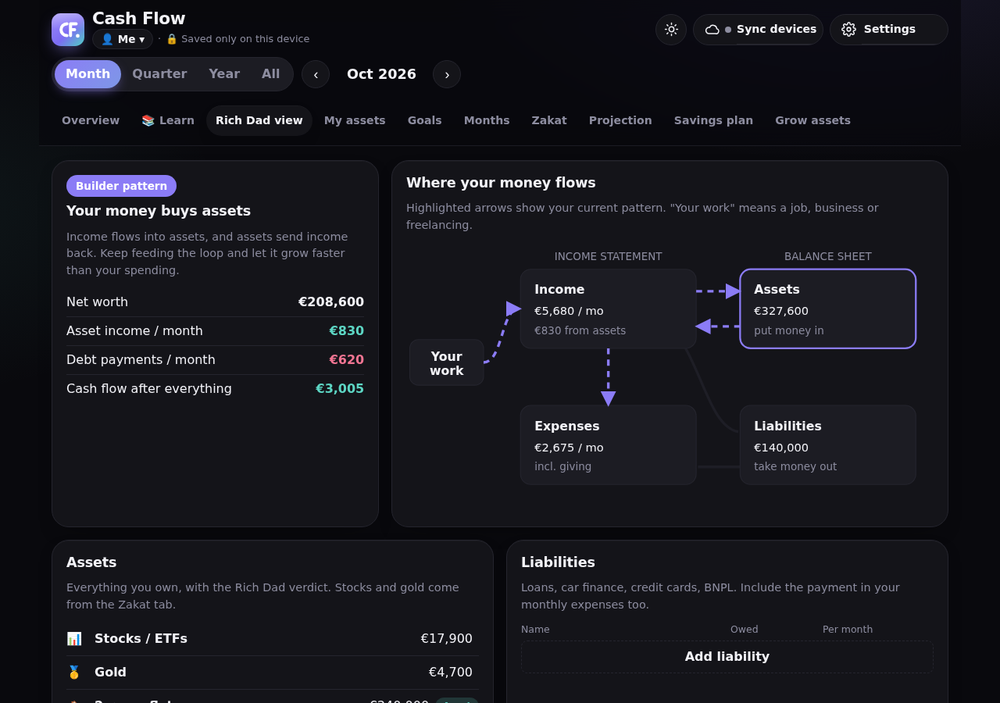
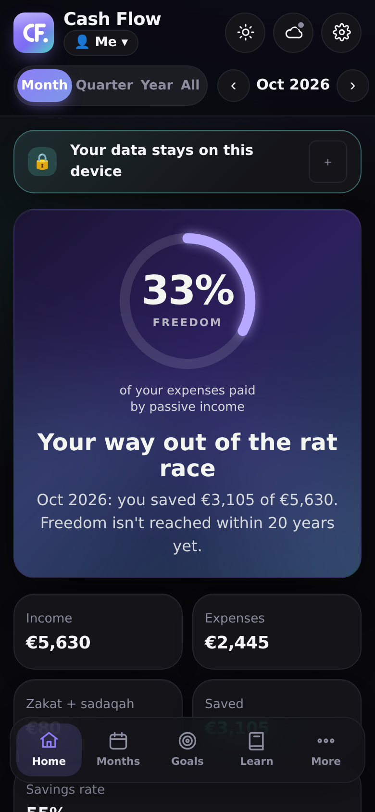

<p align="center"></p>

<h1 align="center">Cash Flow</h1>

<p align="center">
  A private personal-finance planner <b>and guide</b> that teaches you to build assets, step by step.<br>
  Inspired by <i>Rich Dad Poor Dad</i>. Built-in zakat & sadaqah. Halal-friendly investing guidance.
</p>

<p align="center">
  <a href="https://fahadkhalid.github.io/cash-flow/"><b>Open the app →</b></a> ·
  No install · No account · Your data never leaves your device
</p>



---

## Contents

- [Features](#features)
- [Use it](#use-it)
- [Privacy](#privacy)
- [Tech stack](#tech-stack)
- [Project structure](#project-structure)
- [Architecture](#architecture)
- [Data model](#data-model)
- [Optional Google Drive sync](#optional-google-drive-sync)
- [Testing](#testing)
- [Quality, performance & accessibility](#quality-performance--accessibility)
- [Contributing](#contributing)
- [Disclaimer](#disclaimer) · [License](#license)

---

## Features

### Track

- **Monthly entries**: salary, extra income, passive income, expenses, sadaqah and zakat paid. Copy last month in one tap.
- **Views**: month, quarter, year or all time, with charts, category breakdown and a year-by-year table.
- **My assets**: plots, rental homes, shops, your home, companies and partnerships (with ownership %), apps, websites/SaaS, e-books and courses, content channels, vehicles. Each gets a *Rich Dad verdict* (asset, liability or store of value), net cash flow, yield, ROI and loans.
- **Investments**: stocks/ETFs, funds, gold, silver, crypto. Record buys, update the value whenever you check, record sales and dividends. Shows invested vs. value, realized and unrealized gain, average cost and history. No monthly typing.
- **Goals** with deadlines and the monthly saving needed, checked against what you actually save.
- **Zakat**: nisab from the gold price, zakat due vs. paid, trade goods from your assets.
- **Net worth history**, **projection** (5–60 years) with your financial-freedom year, and a **savings plan** (emergency fund first, then your split).

### Learn

- **Rich Dad view**: income statement and balance sheet with an animated cash-flow diagram that shows your current pattern.
- **A 10-step path to financial freedom** that checks itself from your data, with levels and celebrations.
- **Think and Grow Rich toolkit**: a step-by-step *desire statement* builder (exact amount, what you give in return, date, plan) that creates a linked goal and shows the monthly saving needed; morning and night *reading check-ins* with a streak; a *persistence score* measured from your real logging, saving and reading chains; and a *temporary defeat log* for setbacks and comebacks.
- **24 lessons**, **6 topic quizzes** that unlock after reading, **three money mindsets** with a self-check, **wisdom from the Quran and Sunnah** (with references), and real stories.
- **Games & simulators**: *Cashflow Challenge*, *Asset or liability?*, *The snowball*, *Early vs. late*, *Cost of a habit*, *Three feet from gold*.
- **Spending check-up**: spots subscriptions, eating out, smoking, impulse shopping and more, and suggests kinder, cheaper swaps.

### Everywhere

- Profiles for shared devices · light, dark and auto theme · fully responsive from 320 px phones to wide desktops · works offline.

| Learn | My assets | Rich Dad view |
|---|---|---|
|  |  |  |

<p align="center"></p>

## Use it

**In the browser (everyone):** open **<https://fahadkhalid.github.io/cash-flow/>**. On a phone, use *Share → Add to Home Screen* for an app-like icon.

**Locally:**

```bash
git clone https://github.com/FahadKhalid/cash-flow.git
cd cash-flow
python3 serve.py          # opens http://localhost:8090 with caching disabled
```

Opening `index.html` directly also works. The running version is shown in **Settings**.

**Move data to another device:** *Settings → Export backup* on the old device, then *Settings → Import backup* on the new one. Each browser address keeps its own data.

## Privacy

- **No server, no account, no analytics, no ads, no cookies.** The app is static files.
- Data is stored in the browser's `localStorage` for that address, per profile. *Settings → Where your data is* shows the exact location on disk.
- The only network request is Google sign-in, and only if a user turns on sync. Synced data goes to a hidden app folder in **their own** Google Drive (`drive.appdata` scope) that only this app can read.
- All user text is rendered with `textContent`, never `innerHTML`, so stored text can't inject scripts. Imported files are validated by a sanitizer before use.

See [SECURITY.md](SECURITY.md) to report a vulnerability.

## Tech stack

| Layer | Choice | Why |
|---|---|---|
| UI | Semantic **HTML5**, **CSS3** (custom properties, grid, `color-mix`, `backdrop-filter`) | No framework, nothing to install, loads instantly |
| Logic | **Vanilla JavaScript** (ES2020+, strict mode) | Zero runtime dependencies, runs in any modern browser |
| Charts | Own **inline-SVG chart engine** (bar, line, area, doughnut) | Works offline, follows the theme, ~150 lines |
| Storage | **Web Storage** (`localStorage`, `sessionStorage`) | Private by default; data never leaves the device |
| Formatting | **Intl.NumberFormat** (cached) | Any ISO currency, local number style |
| Sync (optional) | **Google Identity Services** + **Drive REST v3** (`appDataFolder`) | User-owned storage, no backend |
| Hosting | **GitHub Pages** (static) | Free, HTTPS, no server to maintain |
| Local server | `serve.py` (Python standard library) | No-cache headers so updates always show |
| Tests | **Python + Playwright** (Chromium) | Unit, integration, fuzzing, sync failures, performance, responsive |
| CI | **GitHub Actions** | Runs the full suite on every push and pull request |

## Project structure

```text
cash-flow/
├── index.html              # markup only
├── css/app.css             # all styles: theme tokens, components, responsive rules
├── js/app.js               # the whole app, in documented sections (see file header)
├── tests/test_cashflow.py  # automated test suite
├── serve.py                # local no-cache dev server
├── screenshots/            # README images
├── logo.svg · logo-512.png
├── .github/workflows/tests.yml
├── CONTRIBUTING.md · SECURITY.md · LICENSE
└── .editorconfig · .gitignore
```

## Architecture

```text
user input ──► change() ──► S (state) ──► stamp() per-section timestamps
                  │                         │
                  ├─► render() visible tab  ├─► localStorage (debounced)
                  │                         └─► syncNow() ─► Drive appDataFolder
                  └─► count-up animations       (download → merge → upload)
```

- **State.** One object `S` per profile. `migrate()` upgrades any older format, `cleanDemo()` removes sample data from early versions, and `sanitize()` forces every field to the right type and range, so corrupted or hostile data can't crash the app.
- **Rendering.** `render()` only draws the visible tab, so a full update takes about 10–25 ms even with 15 years of data. Number formatters are cached. Animations cancel each other safely (no stale values).
- **Sync.** Offline first. Each month, goal, asset and investment has its own timestamp; deletions are tombstones. On sync the app downloads, merges per section (newest wins, union of new items), and uploads. It retries on reconnect, on tab focus and every minute.
- **Investments.** Stored as a list of transactions (`buy`, `sell`, `val`, `div`). Value, cost basis (average cost), realized and unrealized gain and history are derived, so editing history always stays consistent.
- **Charts.** A small SVG engine with `ResizeObserver`, CSS-variable colours (theme-aware) and tooltips.

## Data model

A profile's data (also the format of an exported backup), abridged:

```json
{
  "currency": "EUR",
  "log": { "2026-10": { "income": [{ "n": "Salary", "a": 4200 }], "extra": [], "passive": [],
                        "expenses": [{ "n": "Rent", "a": 1250 }], "sadaqah": 80, "zakatPaid": 0 } },
  "assets": { "cash": 9000, "emergency": 12000, "stocks": 17900, "gold": 4700 },
  "port":  [{ "id": "…", "type": "rental", "n": "2-room flat", "v": 240000, "own": 100,
              "inc": 950, "cost": 300, "lo": 140000, "lp": 620, "g": 3, "zk": false }],
  "inv":   [{ "id": "…", "type": "fund", "n": "Index fund",
              "tx": [{ "k": "buy", "amt": 10000, "d": "2026-03" }, { "k": "val", "amt": 17900, "d": "2026-09" }] }],
  "goals": [{ "id": "…", "n": "Umrah", "t": 6000, "s": 2400, "d": "2027-11" }],
  "learn": { "purpose": "…", "read": {}, "quiz": {}, "games": {} },
  "mt": {}, "del": {}
}
```

Storage keys: `cashflow:profiles`, `cashflow:active`, `cashflow:data:<profileId>`.

## Optional Google Drive sync

> **Currently hidden in the app.** To show the *Sync devices* button and the settings card again, set `SYNC_UI = true` in `js/app.js`.

Each deployment needs its own free OAuth Client ID:

1. [Google Cloud Console](https://console.cloud.google.com) → create a project → enable **Google Drive API**.
2. **OAuth consent screen** → *External* → add the scope `…/auth/drive.appdata` → add test users (personal use can stay in *Testing*).
3. **Credentials → OAuth client ID → Web application** → *Authorized JavaScript origins*, e.g. `https://<you>.github.io` and `http://localhost:8090`.
4. Paste the Client ID in the app (*☁️ Sync devices*), or set `GOOGLE_CLIENT_ID` in `js/app.js` for everyone using your deployment.

## Testing

```bash
pip install playwright && playwright install chromium
python tests/test_cashflow.py
```

127 automated checks:

| Area | What is verified |
|---|---|
| Unit | totals per month/quarter/year, savings rate, zakat & nisab, asset verdicts, ownership %, net worth, projection, sync merge (conflicts, deletions, idempotency), migration, chart ticks |
| Integration | first run, logging a month through the UI, copying months, all views, goals, assets, investments (buy → update → sell → dividend), zakat, projection, savings plan, learn, quizzes, games, backup/import, profiles, theme, erase |
| Robustness | invalid JSON, wrong types, script injection, 40 rounds of random fuzzing, every legacy data format |
| Sync | server errors, expired login, garbage responses, offline → online, two devices editing the same data |
| Performance | 15 years of months, 100 assets, 50 goals: render, tab switch, page load, typing |
| Layout & a11y | 10 screen widths × 10 tabs × 8 dialogs without horizontal scroll; every button and input has an accessible name |

CI runs the suite on every push ([workflow](.github/workflows/tests.yml)).

## Quality, performance & accessibility

- Strict mode, no globals leaked by accident, no `eval`, no external scripts unless sync is enabled.
- Every value shown is guarded against `NaN`/`Infinity`; inputs are clamped (ownership 0–100 %, years 1–60…).
- Respects **prefers-reduced-motion** and **prefers-color-scheme**; 44 px touch targets; numeric keypad on phones; iPhone safe areas.
- Browser support: current Chrome, Edge, Safari, Firefox, and their mobile versions.

## Contributing

Issues and pull requests are welcome: translations, more currencies, new lessons, debt-payoff planner, other sync providers. Read [CONTRIBUTING.md](CONTRIBUTING.md) first; please keep it dependency-free and private by design.

## Disclaimer

Cash Flow is a planning and education tool, **not financial or religious advice**. Lessons are original summaries of widely known ideas and credit their books; please read and support the original authors. The zakat calculation is simplified; check your situation with a scholar you trust. Not affiliated with or endorsed by Robert Kiyosaki or the Rich Dad Company.

## License

[MIT](LICENSE)
